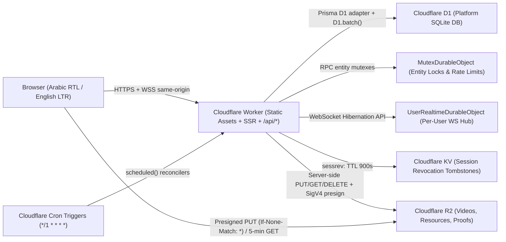
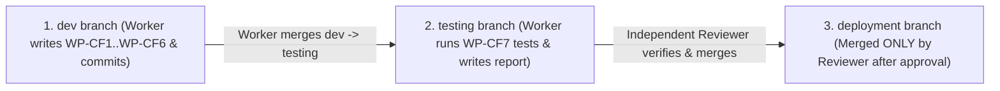

# Cloudflare D1 + Workers migration and multi-teacher / multi-subject implementation contract & verification plan

Planning date: 2026-11-22. Status: **approved specification for worker implementation and independent reviewer verification**.

This document is the authoritative implementation specification and verification manual for:
1. Refactoring the catalog, packages, purchases, and bilingual UI to support **multiple admin-managed teachers** and **multiple admin-managed subjects** within courses.
2. Migrating the entire platform backend, database, realtime hub, background jobs, and SSR gateway off Railway/Vercel onto a **100% Cloudflare stack** (**Cloudflare Workers + Static Assets**, **Cloudflare D1**, **Cloudflare Durable Objects**, **Cloudflare KV**, **Cloudflare Cron Triggers**, and **Cloudflare R2**).

No application source, Prisma schema, migration, or deployment file is modified by this plan document. Work must be executed one bounded work package (`WP-CF1` → `WP-CF7`) at a time by the implementation worker and independently verified by the reviewer before advancing to the next package.

---

## 0. Confirmed owner decisions & non-negotiable invariants

### Confirmed decisions (2026-11-22)
1. **Strictly two platform roles (`STUDENT` and `ADMIN`)**: Do **not** add a `TEACHER` login role or teacher authentication accounts. Only `ADMIN` controls everything. Teachers are admin-managed bilingual catalog records (`Teacher`) attached to courses.
2. **Wallet recharges & financial summaries unchanged**: Keep manual EGP recharge requests, super-admin receipt verification, and existing admin summary screens as-is. Do **not** build a per-teacher financial summary screen.
3. **3-course package rule (`CoursePackage`)**: All 3 monthly courses in a package must share the exact same `grade`, the same `subjectId`, and the same `teacherId`.
4. **Admin-managed bilingual `Subject` table**: Subjects (`nameAr`, `nameEn`, `slug`, `position`, `active`) are managed by `ADMIN` in the database rather than a hardcoded enum.
5. **100% Cloudflare deployment with Cloudflare D1**: No Railway services and no external PostgreSQL/Redis accounts. All relational persistence lives in Cloudflare D1 (SQLite).

### Non-negotiable project invariants ([rules.md](../rules.md), [decisions.md](../decisions.md))
- **Money integrity**: All balances, prices, and ledger entries are integer EGP piastres (`Int`). Floating-point money arithmetic is forbidden. Wallet credit occurs only on authenticated `ADMIN` approval after receipt verification (`receiptVerified: true`).
- **Cookie-only authentication**: 15-minute access JWT (`edu_access`) and 30-day rotating SHA-256 refresh credential (`edu_refresh`) in `HttpOnly` (`Secure` in production, `SameSite=Lax`) cookies paired with double-submit/session-bound `edu_csrf`. Never store auth tokens in `localStorage` or `sessionStorage`.
- **Bilingual parity**: Arabic (`ar`, RTL, primary/default) and English (`en`, LTR, secondary) are mandatory on all user-facing and admin-authored entities (`Course`, `CourseSection`, `Lesson`, `Subject`, `Teacher`, `CoursePackage`, `LessonResource`).
- **Disabled-action explanations ([design.md](../design.md))**: Every disabled button/control across student and admin screens must render a visible bilingual explanation of the unmet condition and next step beside the control, associated via `aria-describedby`, without requiring hover or focus.
- **External DRM boundary**: `education-drm-service/` is an independent external package and must **never** be edited by any work package in this plan.
- **Mandatory Docker test cleanup (2026-10-01 owner rule)**: Every worker and reviewer execution must inspect project labels and resolved container/network/volume mounts before starting or removing test containers, clean up all owned disposable test containers/networks/volumes upon completion/failure/stop, preserve existing previews and unrelated volumes, and **never** run `docker system prune` or global prune commands.

---

## 1. Target architecture (100% Cloudflare stack)



---

## 2. Exact Prisma schema specification (`server/prisma/schema.prisma`)

### 2.1 Datasource & generator changes (applied in `WP-CF4`)
```prisma
generator client {
  provider        = "prisma-client-js"
  previewFeatures = ["driverAdapters"]
}

datasource db {
  provider = "sqlite"
  url      = env("DATABASE_URL")
}
```
> **Sequencing note**: In `WP-CF1` and `WP-CF2`, keep `provider = "postgresql"` while developing and verifying the multi-teacher and multi-subject schema/API/UI against the existing test suite. In `WP-CF4`, switch `schema.prisma` to `provider = "sqlite"` with `@prisma/adapter-d1` and generate the canonical D1 SQLite migrations under `server/migrations/`.

### 2.2 New models: `Subject` and `Teacher` (added in `WP-CF1`)
```prisma
/// Admin-managed bilingual academic subject (e.g., Programming, Mathematics, Physics).
model Subject {
  id        String   @id @default(uuid())
  slug      String   @unique
  nameAr    String
  nameEn    String
  position  Int      @default(1)
  active    Boolean  @default(true)
  createdAt DateTime @default(now())
  updatedAt DateTime @updatedAt
  courses   Course[]

  @@index([active, position])
}

/// Admin-managed bilingual teacher profile (catalog attribution only; no teacher login role).
model Teacher {
  id        String   @id @default(uuid())
  slug      String   @unique
  nameAr    String
  nameEn    String
  bioAr     String?
  bioEn     String?
  position  Int      @default(1)
  active    Boolean  @default(true)
  createdAt DateTime @default(now())
  updatedAt DateTime @updatedAt
  courses   Course[]

  @@index([active, position])
}
```

### 2.3 Exact modifications to existing models (`Course`, `Purchase`, `PackagePurchaseItem`, `RechargeProof`)

1. **`Course` ([schema.prisma](file:///c:/Users/AT010/OneDrive/Desktop/JavaScript/Fullstack/Github/education-platform/server/prisma/schema.prisma#L153-L190))**:
   Add optional foreign keys `subjectId` and `teacherId` with `onDelete: Restrict` (so an admin cannot hard-delete a subject or teacher that is referenced by any course or historical working copy):
   ```prisma
   subjectId     String?
   subject       Subject? @relation(fields: [subjectId], references: [id], onDelete: Restrict)
   teacherId     String?
   teacher       Teacher? @relation(fields: [teacherId], references: [id], onDelete: Restrict)

   @@index([grade, subjectId, teacherId, academicYear, term, courseKind])
   @@index([subjectId, status])
   @@index([teacherId, status])
   ```

2. **`Purchase` ([schema.prisma](file:///c:/Users/AT010/OneDrive/Desktop/JavaScript/Fullstack/Github/education-platform/server/prisma/schema.prisma#L615-L631))**:
   Add immutable snapshot columns (plain nullable strings, **no foreign keys**, matching `planId`/`courseId` historical snapshot design under D04/D14):
   ```prisma
   subjectId     String?
   subjectNameAr String?
   subjectNameEn String?
   teacherId     String?
   teacherNameAr String?
   teacherNameEn String?
   ```

3. **`PackagePurchaseItem` ([schema.prisma](file:///c:/Users/AT010/OneDrive/Desktop/JavaScript/Fullstack/Github/education-platform/server/prisma/schema.prisma#L711-L720))**:
   Add immutable snapshot columns per package member course:
   ```prisma
   subjectId     String?
   subjectNameAr String?
   subjectNameEn String?
   teacherId     String?
   teacherNameAr String?
   teacherNameEn String?
   ```

4. **`RechargeProof`, `CourseCover`, and `InstaPaySettings` ([schema.prisma](file:///c:/Users/AT010/OneDrive/Desktop/JavaScript/Fullstack/Github/education-platform/server/prisma/schema.prisma#L601-L610)) — applied in `WP-CF3` (Workers Paid Plan 5 GB D1 cost guard)**:
   Cloudflare D1 has a hard 1 MB (`1,048,576` bytes) row and bound-parameter limit and a 5 GB included storage quota on the \$5/month Workers Paid Plan. To keep D1 100% free of binary blobs in production, offload `RechargeProof` (up to 5 MiB), `CourseCover` (up to 128 KiB), and `InstaPaySettings` QR images (up to 128 KiB) to private R2 keys when `StorageClient` is configured:
   ```prisma
   model CourseCover {
     id         String   @id @default(uuid())
     bytes      Bytes?
     storageKey String?  @unique
     mime       String
     courses    Course[]
     createdAt  DateTime @default(now())
   }

   model RechargeProof {
     requestId  String          @id
     request    RechargeRequest @relation(fields: [requestId], references: [id], onDelete: Cascade)
     bytes      Bytes?          // Null when stored in R2 via storageKey; retained only for unit tests when storage is unconfigured
     storageKey String?         @unique
     mime       String
     size       Int
     hash       String
     cleanedAt  DateTime?
     createdAt  DateTime        @default(now())
   }

   model InstaPaySettings {
     id             Int      @id
     enabled        Boolean
     accountLabel   String
     instructionsAr String
     instructionsEn String
     version        Int      @default(1)
     updatedAt      DateTime @updatedAt
     qrBytes        Bytes?
     qrStorageKey   String?
     qrMime         String?
   }
   ```

---

## 3. Detailed specification by work package

---

### WP-CF1: Multi-teacher & multi-subject backend schema, validation, and APIs

#### 3.1.1 Subject & Teacher validation rules (`server/src/modules/catalog/subjects.ts`, `server/src/modules/catalog/teachers.ts`)
- **`Subject` input fields**:
  - Create (`POST /admin/subjects`): `rejectUnknownFields(raw, new Set(['slug', 'nameAr', 'nameEn', 'position', 'active']))`
    - `slug`: `validateSlug(body.slug)` (lowercase alphanumeric + hyphens, 2–80 chars, unique; duplicate throws `409 SLUG_TAKEN`).
    - `nameAr`: `nonBlankString(body.nameAr, 'nameAr', 120)`
    - `nameEn`: `nonBlankString(body.nameEn, 'nameEn', 120)`
    - `position`: optional positive integer `1..10000` (defaults to `max(position) + 1` or `1`).
    - `active`: optional boolean (defaults to `true`).
  - Update (`PATCH /admin/subjects/:id`): same fields, all optional; at least one field required (`400 VALIDATION_ERROR` if empty).
  - Delete (`DELETE /admin/subjects/:id`):
    - Check `await prisma.course.count({ where: { subjectId: id } })`.
    - If `count > 0`, throw `new ApiError(409, 'SUBJECT_IN_USE', 'Cannot delete a subject assigned to courses. Deactivate it instead.')`.
    - Otherwise delete and record `AuditEvent` (`SUBJECT_DELETED`).
- **`Teacher` input fields**:
  - Create (`POST /admin/teachers`): `rejectUnknownFields(raw, new Set(['slug', 'nameAr', 'nameEn', 'bioAr', 'bioEn', 'position', 'active']))`
    - `slug`: `validateSlug(body.slug)` (duplicate throws `409 SLUG_TAKEN`).
    - `nameAr`: `nonBlankString(body.nameAr, 'nameAr', 120)`
    - `nameEn`: `nonBlankString(body.nameEn, 'nameEn', 120)`
    - `bioAr`: optional `string | null` (when non-null string, trim and max 2000 chars; empty string normalizes to `null`).
    - `bioEn`: optional `string | null` (when non-null string, trim and max 2000 chars; empty string normalizes to `null`).
    - `position`: optional positive integer `1..10000`.
    - `active`: optional boolean (defaults to `true`).
  - Update (`PATCH /admin/teachers/:id`): same fields, all optional; at least one field required.
  - Delete (`DELETE /admin/teachers/:id`):
    - Check `await prisma.course.count({ where: { teacherId: id } })`.
    - If `count > 0`, throw `new ApiError(409, 'TEACHER_IN_USE', 'Cannot delete a teacher assigned to courses. Deactivate the teacher instead.')`.
    - Otherwise delete and record `AuditEvent` (`TEACHER_DELETED`).
- **Audit trail**:
  - Record `SUBJECT_CREATED`, `SUBJECT_UPDATED`, `SUBJECT_DELETED`, `TEACHER_CREATED`, `TEACHER_UPDATED`, `TEACHER_DELETED` via `audit()`.

#### 3.1.2 Public and Admin Catalog Endpoints (`server/src/modules/catalog/routes/`)
- **Public endpoints (`server/src/modules/catalog/routes/public.ts`)**:
  - `GET /catalog/subjects`: returns `ok({ subjects })` listing all `Subject` rows where `active: true`, ordered by `[{ position: 'asc' }, { createdAt: 'asc' }]`, shape:
    `{ id, slug, nameAr, nameEn, position }`.
  - `GET /catalog/teachers`: returns `ok({ teachers })` listing all `Teacher` rows where `active: true`, ordered by `[{ position: 'asc' }, { createdAt: 'asc' }]`, shape:
    `{ id, slug, nameAr, nameEn, bioAr, bioEn, position }`.
  - `GET /catalog/courses`: extend allowed query parameters in `listPublishedCourses()` ([courses/service.ts](file:///c:/Users/AT010/OneDrive/Desktop/JavaScript/Fullstack/Github/education-platform/server/src/modules/catalog/courses/service.ts#L80-L122)) from `['grade', 'academicYear', 'term', 'courseKind', 'teachingMonth']` to also accept:
    - `subjectId` (UUID validated via `assertUuid`)
    - `teacherId` (UUID validated via `assertUuid`)
    - `subjectSlug` (validated via `validateSlug`, filters `subject: { slug: value, active: true }`)
    - `teacherSlug` (validated via `validateSlug`, filters `teacher: { slug: value, active: true }`)
  - `PublicCourse` response shape ([types.ts](file:///c:/Users/AT010/OneDrive/Desktop/JavaScript/Fullstack/Github/education-platform/server/src/modules/catalog/types.ts), [courses/service.ts](file:///c:/Users/AT010/OneDrive/Desktop/JavaScript/Fullstack/Github/education-platform/server/src/modules/catalog/courses/service.ts#L30-L78)):
    Include `subject` and `teacher` objects on every returned `PublicCourse`:
    ```ts
    subject: row.subject
      ? { id: row.subject.id, slug: row.subject.slug, nameAr: row.subject.nameAr, nameEn: row.subject.nameEn }
      : null,
    teacher: row.teacher
      ? { id: row.teacher.id, slug: row.teacher.slug, nameAr: row.teacher.nameAr, nameEn: row.teacher.nameEn, bioAr: row.teacher.bioAr, bioEn: row.teacher.bioEn }
      : null,
    ```
- **Admin endpoints (`server/src/modules/catalog/routes/index.ts`)**:
  - Mount `createSubjectAdminRouter(ctx)` and `createTeacherAdminRouter(ctx)` under `/admin` (protected by `requireAdmin` + CSRF middleware, matching `courses.ts` and `packages.ts`):
    - `GET /admin/subjects` → returns all subjects (active and inactive) with `_count: { select: { courses: true } }`.
    - `POST /admin/subjects` → `201` with `{ data: { subject } }`.
    - `PATCH /admin/subjects/:id` → `200` with `{ data: { subject } }`.
    - `DELETE /admin/subjects/:id` → `200` with `{ data: { deleted: true } }`.
    - `GET /admin/teachers` → returns all teachers (active and inactive) with `_count: { select: { courses: true } }`.
    - `POST /admin/teachers` → `201` with `{ data: { teacher } }`.
    - `PATCH /admin/teachers/:id` → `200` with `{ data: { teacher } }`.
    - `DELETE /admin/teachers/:id` → `200` with `{ data: { deleted: true } }`.

#### 3.1.3 Course authoring, working copies, and lifecycle rules
1. **`createCourse` & `updateCourse` ([courses/service.ts](file:///c:/Users/AT010/OneDrive/Desktop/JavaScript/Fullstack/Github/education-platform/server/src/modules/catalog/courses/service.ts))**:
   - Add `'subjectId'` and `'teacherId'` to `CREATE_FIELDS` and `UPDATE_FIELDS`.
   - When `subjectId !== undefined`: allow `null` (while in `DRAFT`) or a valid UUID referencing an existing `Subject` (`404 SUBJECT_NOT_FOUND` if missing; `409 SUBJECT_INACTIVE` if `!subject.active`).
   - When `teacherId !== undefined`: allow `null` (while in `DRAFT`) or a valid UUID referencing an existing `Teacher` (`404 TEACHER_NOT_FOUND` if missing; `409 TEACHER_INACTIVE` if `!teacher.active`).
2. **Working copies ([courses/revisions.ts](file:///c:/Users/AT010/OneDrive/Desktop/JavaScript/Fullstack/Github/education-platform/server/src/modules/catalog/courses/revisions.ts#L7))**:
   - Update `details(c: Course)` on line 7 of `revisions.ts` to include `subjectId: c.subjectId, teacherId: c.teacherId`:
     ```ts
     const details = (c: Course) => ({
       titleAr: c.titleAr,
       titleEn: c.titleEn,
       descriptionAr: c.descriptionAr,
       descriptionEn: c.descriptionEn,
       coverId: c.coverId,
       grade: c.grade,
       academicYear: c.academicYear,
       term: c.term,
       courseKind: c.courseKind,
       teachingMonth: c.teachingMonth,
       subjectId: c.subjectId,
       teacherId: c.teacherId,
     });
     ```
   - Update `effectiveHierarchy()` in `revisions.ts` and `listCoursesAdmin()` in `courses/service.ts` to `include: { subject: true, teacher: true, ... }`.
3. **Publication readiness ([lifecycle/policy.ts](file:///c:/Users/AT010/OneDrive/Desktop/JavaScript/Fullstack/Github/education-platform/server/src/modules/catalog/lifecycle/policy.ts))**:
   - When a course has academic placement (`course.grade !== null`) or when transitioning to `PUBLISHED` (`validateReadyForPublish`), if `course.subjectId` references an inactive subject or `course.teacherId` references an inactive teacher, append `'subject is inactive'` / `'teacher is inactive'` to `issues` so `409 PUBLICATION_BLOCKED` is raised.
   - *(Backward-compatibility note for existing fixture tests)*: Existing unit/integration tests that create minimal courses without `subjectId` or `teacherId` must continue to pass unless `subjectId`/`teacherId` is explicitly provided or required by a package; however, in the Admin Course Editor UI (`WP-CF2`) and for any 3-course `CoursePackage`, both `subjectId` and `teacherId` are required.

#### 3.1.4 3-Course Package (`CoursePackage`) enforcement ([catalog/packages.ts](file:///c:/Users/AT010/OneDrive/Desktop/JavaScript/Fullstack/Github/education-platform/server/src/modules/catalog/packages.ts))
In `lockedMembers(tx, ids, published)` ([packages.ts](file:///c:/Users/AT010/OneDrive/Desktop/JavaScript/Fullstack/Github/education-platform/server/src/modules/catalog/packages.ts#L38-L62)):
1. Query `rows` with `include: { subject: true, teacher: true }`.
2. Require every member course to have a non-null active `subjectId` and a non-null active `teacherId`:
   - If any course has `!c.subjectId || !c.subject?.active`, throw `new ApiError(409, 'PACKAGE_UNAVAILABLE', 'All package courses must have an active subject.')`.
   - If any course has `!c.teacherId || !c.teacher?.active`, throw `new ApiError(409, 'PACKAGE_UNAVAILABLE', 'All package courses must have an active teacher.')`.
3. Enforce same `grade`, same `subjectId`, and same `teacherId` across all 3 courses:
   - `if (new Set(rows.map((course) => course.grade)).size !== 1)` → `throw new ApiError(409, 'PACKAGE_GRADE_MISMATCH', 'All package courses must be from the same grade.')`
   - `if (new Set(rows.map((course) => course.subjectId)).size !== 1)` → `throw new ApiError(409, 'PACKAGE_SUBJECT_MISMATCH', 'All package courses must be from the same subject.')`
   - `if (new Set(rows.map((course) => course.teacherId)).size !== 1)` → `throw new ApiError(409, 'PACKAGE_TEACHER_MISMATCH', 'All package courses must be from the same teacher.')`
4. In `publicPackage(row)` ([packages.ts](file:///c:/Users/AT010/OneDrive/Desktop/JavaScript/Fullstack/Github/education-platform/server/src/modules/catalog/packages.ts#L128-L164)):
   - Update `memberInclude` to `members: { orderBy: { position: 'asc' as const }, include: { course: { include: { subject: true, teacher: true } } } }`.
   - Include in `available`:
     `new Set(row.members.map((m) => m.course.subjectId)).size === 1 && new Set(row.members.map((m) => m.course.teacherId)).size === 1 && row.members.every((m) => Boolean(m.course.subjectId && m.course.teacherId))`
   - Expose top-level `grade`, `subject`, and `teacher` on `publicPackage(row)` (derived from the first member when homogeneous) and on each member in `courses[]`.

#### 3.1.5 Immutable purchase snapshots ([wallet/purchase/service.ts](file:///c:/Users/AT010/OneDrive/Desktop/JavaScript/Fullstack/Github/education-platform/server/src/modules/wallet/purchase/service.ts), [wallet/purchase/packages.ts](file:///c:/Users/AT010/OneDrive/Desktop/JavaScript/Fullstack/Github/education-platform/server/src/modules/wallet/purchase/packages.ts))
1. **Standalone course purchase (`purchaseCourse` in `wallet/purchase/service.ts`)**:
   - When loading `plan` (line 101), include `course: { select: { id: true, slug: true, status: true, subjectId: true, teacherId: true, subject: { select: { nameAr: true, nameEn: true } }, teacher: { select: { nameAr: true, nameEn: true } } } }`.
   - On `tx.purchase.create` (line 167), persist:
     ```ts
     subjectId: plan.course.subjectId,
     subjectNameAr: plan.course.subject?.nameAr ?? null,
     subjectNameEn: plan.course.subject?.nameEn ?? null,
     teacherId: plan.course.teacherId,
     teacherNameAr: plan.course.teacher?.nameAr ?? null,
     teacherNameEn: plan.course.teacher?.nameEn ?? null,
     ```
   - Include these 6 fields in `toPurchaseView()` and `listMyPurchases()`.
2. **Package purchase (`purchasePackage` in `wallet/purchase/packages.ts`)**:
   - `lockedMembers` already returns the 3 courses with `subject` and `teacher`.
   - On `tx.packagePurchase.create` → `items.create` (line 118), persist on each `PackagePurchaseItem`:
     ```ts
     courseId: c.id,
     titleAr: c.titleAr,
     titleEn: c.titleEn,
     position: i + 1,
     subjectId: c.subjectId,
     subjectNameAr: c.subject?.nameAr ?? null,
     subjectNameEn: c.subject?.nameEn ?? null,
     teacherId: c.teacherId,
     teacherNameAr: c.teacher?.nameAr ?? null,
     teacherNameEn: c.teacher?.nameEn ?? null,
     ```

---

### WP-CF2: Multi-teacher & multi-subject bilingual frontend UI

#### 3.2.1 Localization strings (`client/src/locales/ar.ts`, `client/src/locales/en.ts`)
Add complete Arabic and English keys for:
- Subject labels: `subject` (`المادة` / `Subject`), `allSubjects` (`كل المواد` / `All subjects`), `manageSubjects` (`إدارة المواد` / `Manage subjects`), `addSubject` (`إضافة مادة` / `Add subject`), `subjectRequiredReason` (`اختر المادة أولاً للمتابعة.` / `Select a subject first to continue.`).
- Teacher labels: `teacher` (`المدرس` / `Teacher`), `allTeachers` (`كل المدرسين` / `All teachers`), `manageTeachers` (`إدارة المدرسين` / `Manage teachers`), `addTeacher` (`إضافة مدرس` / `Add teacher`), `teacherBio` (`نبذة عن المدرس` / `Teacher bio`), `teacherRequiredReason` (`اختر المدرس أولاً للمتابعة.` / `Select a teacher first to continue.`).
- Package homogeneity explanations: `packageSameGradeSubjectTeacherReason` (`يجب أن تنتمي الكورسات الثلاثة لنفس الصف ونفس المادة ونفس المدرس.` / `All three courses must belong to the same grade, subject, and teacher.`).

#### 3.2.2 Student discovery & purchase screens
1. **`HomePage.tsx` & `PublicCatalogPage.tsx`**:
   - Fetch `/api/catalog/subjects` and `/api/catalog/teachers` alongside published courses and packages.
   - Render accessible filter pills/selectors for **Grade** (`FIRST_SECONDARY` / `SECOND_SECONDARY`), **Subject** (`All` + active subjects), **Teacher** (`All` + active teachers), and **Term** (`1` / `2`).
   - Display the localized Subject badge and Teacher name on every course card and package card.
2. **`OfferPage.tsx` & `PackagePage.tsx`**:
   - Show the course's Subject and Teacher (including localized teacher bio when present) in the offer header.
   - Show snapshotted Subject and Teacher names in `PurchaseHistoryPage.tsx`.

#### 3.2.3 Admin catalog, package, and subject/teacher management screens
1. **`AdminListPage.tsx`**:
   - Add two collapsible management panels (or tabs) at the top of the Admin Catalog workspace: **Subjects (`إدارة المواد`)** and **Teachers (`إدارة المدرسين`)** with create, inline edit, active toggle, and guarded delete (showing the disabled reason beside Delete when `_count.courses > 0`).
2. **`AdminDetailPage.tsx` (Course Editor)**:
   - Add required **Subject** and **Teacher** dropdown selectors inside the course academic metadata form, populated from `/api/admin/subjects` and `/api/admin/teachers`.
   - Show visible bilingual disabled reasons beside the save/publish controls when a required subject or teacher is unselected or inactive.
3. **`AdminPackagesPage.tsx` (Package Editor)**:
   - Filter candidate monthly courses by the selected Grade, Subject, and Teacher (or show a visible bilingual disabled reason next to Save when the 3 selected courses do not share the same grade, active subject, and active teacher).

---

### WP-CF3: R2 proof offload & WebCrypto password hashing (removing native C++ `argon2`)

#### 3.3.1 Worker-compatible password hashing (`server/src/modules/identity/password.ts`)
Cloudflare Workers cannot load the native C++ `argon2` node-gyp binary.
1. Remove `"argon2"` from `server/package.json` dependencies.
2. Implement `hashPassword` and `verifyPassword` in `server/src/modules/identity/password.ts` using standard WebCrypto (`crypto.subtle.importKey` + `crypto.subtle.deriveBits` with `PBKDF2` and `SHA-256`, or Node/Workers `crypto.scrypt` via `nodejs_compat`):
   - **Envelope format**: `$pbkdf2-sha256$i=<iterations>$<saltBase64Url>$<hashBase64Url>`
   - **Parameters**:
     - Production iterations: `100_000` (Cloudflare Workers WebCrypto native C++ implementation executes 100k PBKDF2-SHA256 iterations in ~3 ms well within Worker CPU limits).
     - Test iterations (`NODE_ENV === 'test'`): configurable down to `1_000` via existing env overrides so unit/integration tests remain fast.
     - Salt: 16 random bytes (`crypto.getRandomValues(new Uint8Array(16))`); derived key length: 32 bytes (256 bits).
   - **Constant-time comparison**: Use `timingSafeEqual` from `node:crypto` on decoded 32-byte digests.
   - **Keep exported types `Argon2Params`, `PRODUCTION_ARGON2`, `ARGON2_MINIMUMS`, `ARGON2_MAXIMUMS`** as compatibility aliases in `password.ts` and `config.ts` so existing callers and config loaders do not break.

#### 3.3.2 Offloading `RechargeProof`, `CourseCover`, and `InstaPaySettings` QR bytes to Cloudflare R2 (`server/src/modules/wallet/recharge/service.ts`, `cleanup/service.ts`, `catalog/courses/cover.ts`, `wallet/payment-qr.ts`)
1. When `StorageClient` is configured (`createStorageClient(config) !== null`):
   - **`RechargeProof` (`submitRecharge()` & `cleanup/service.ts`)**:
     - Generate `storageKey = \`recharge-proofs/\${requestId}\``.
     - Record a durable `MaterialObject` row (`storageKey`, `state: 'PENDING'`) before uploading to R2 so a mid-request crash never leaves an untracked orphan in R2.
     - Call `await storage.putObject(storageKey, Uint8Array.from(proof.bytes), proof.mime)`.
     - Inside the transaction/batch, create `RechargeProof` with `bytes: null, storageKey, mime: proof.mime, size: proof.bytes.length, hash: proof.hash` and mark `MaterialObject` `'COMMITTED'`.
     - If the DB commit fails, leave `MaterialObject` as `'PENDING'` (or delete immediately) so `reconcileMaterialObjects` cleans up the R2 object.
     - In admin proof download (`GET /admin/recharge-requests/:id/proof`): if `proof.storageKey` is non-null, fetch via `await storage.getObject(proof.storageKey)`; fall back to `proof.bytes` when `storageKey === null`.
     - In 180-day proof retention cleanup (`server/src/modules/wallet/cleanup/service.ts`): for each expired `RechargeProof`, if `storageKey` is present, call `await storage.deleteObject(storageKey)` (tolerating 404), then update `RechargeProof` to `{ bytes: null, storageKey: null, cleanedAt: now }`.
   - **`CourseCover` (`catalog/courses/cover.ts`)**:
     - When `StorageClient` is configured, upload validated cover bytes to `storageKey = \`course-covers/\${coverId}\`` (tracked via `MaterialObject`) and store `bytes: null, storageKey, mime` in `CourseCover`.
     - In `readCourseCover()`, read from `storage.getObject(cover.storageKey)` when `storageKey` is non-null, falling back to `cover.bytes`.
   - **`InstaPaySettings` QR (`wallet/payment-qr.ts`)**:
     - When `StorageClient` is configured, upload validated QR bytes to `qrStorageKey = \`payment-qr/instapay-\${version}\`` (deleting the previous `qrStorageKey` on update/remove) and store `qrBytes: null, qrStorageKey, qrMime`.
     - In `readQr()`, read from `storage.getObject(row.qrStorageKey)` when `qrStorageKey` is non-null, falling back to `row.qrBytes`.

---

### WP-CF4: Cloudflare D1 (SQLite) migration, `MutexDurableObject`, and all 65 raw-SQL adaptations

#### 3.4.1 Why a Durable Object mutex + `D1.batch()` is required
Cloudflare D1's Worker binding (`env.DB`) and `@prisma/adapter-d1` do **not** support stateful multi-roundtrip interactive transactions (`prisma.$transaction(async (tx) => { ... })`) or PostgreSQL row/advisory locks (`FOR UPDATE`, `FOR SHARE`, `pg_advisory_xact_lock`).
To preserve the exact concurrency guarantees required by `rules.md` (e.g. the 4-way concurrent purchase race yielding 1 `201 Created`, 3 `402 INSUFFICIENT_FUNDS`, and 1 debit):

1. **`MutexDurableObject` (`server/src/infra/locks-do.ts`)**:
   - Keyed by entity scope:
     - `wallet:<studentId>` (serializes all wallet debits, credits, purchases, and package purchases for a student)
     - `course:<courseId>` (serializes course lifecycle transitions, hierarchy edits, working-copy creation/publication, and deletion for a course)
     - `package:<packageId>` (serializes package edits)
     - `session:<sessionId>` / `refresh:<tokenHash>` (serializes refresh token rotation and reuse detection)
     - `playback:<studentId>` (serializes concurrent playback session creation against the 2-session limit)
     - `quota:<studentId>` / `assessment:<assessmentId>` (serializes quota consumption and assessment version creation)
     - `bootstrap:global` (serializes one-time first-admin / release-admins bootstrap)
     - `cron:<jobName>` (ensures single-instance execution of scheduled reconcilers)
   - When multiple locks are needed (e.g. package purchase or working-copy lock), acquire them in **sorted lexicographical key order** with a 30-second lease TTL and `finally` release so deadlocks and stuck locks are impossible.
   - For local/unit tests without a Durable Object runtime, provide an in-process `LocalAsyncMutex` implementation implementing the exact same `LockProvider` interface so all existing unit and integration tests run identically.

2. **Transaction wrapper (`withLockedTransaction(deps, lockKeys, fn)`)**:
   - Acquires the sorted entity locks via `LockProvider`.
   - Executes reads against `prisma` (D1), collects write operations (or executes sequential writes protected by the exclusive entity lock + atomic `prisma.$transaction([...batchOps])`), and releases the locks in `finally`.
   - For wallet debits (`wallet/ledger.ts` `postEntry`), always execute an atomic conditional SQL update:
     ```sql
     UPDATE "Wallet"
     SET "balancePiastres" = "balancePiastres" + ?1, "updatedAt" = ?2
     WHERE "id" = ?3 AND ("balancePiastres" + ?1) >= 0
     ```
     and verify `affectedRows === 1` (throwing `402 INSUFFICIENT_FUNDS` if `0`), guaranteeing at the SQLite engine level that a wallet balance can never go negative.

#### 3.4.2 Complete file-by-file inventory of all 24 files (65 raw-SQL queries) to adapt for D1 (SQLite)

| # | File | Line(s) | Current PostgreSQL raw SQL | Exact D1 / SQLite replacement |
| :--- | :--- | :--- | :--- | :--- |
| 1 | `server/src/modules/wallet/ledger.ts` | 33 | `SELECT id, "balancePiastres" FROM "Wallet" WHERE "userId" = ${userId} FOR UPDATE` | Acquire `wallet:<userId>` lock via `LockProvider`, then `prisma.wallet.findUnique({ where: { userId } })` (no `FOR UPDATE`). |
| 2 | `server/src/modules/identity/store.ts` | 58 | `SELECT id FROM "User" WHERE id = ${input.userId} FOR UPDATE` | Acquire `user:<userId>` lock via `LockProvider`, then `prisma.user.findUnique({ where: { id: input.userId } })`. |
| 3 | `server/src/modules/identity/store.ts` | 171 | `SELECT id, "sessionId", consumed FROM "RefreshToken" WHERE "tokenHash" = ${presentedHash} FOR UPDATE` | Acquire `refresh:<presentedHash>` lock via `LockProvider`, then `prisma.refreshToken.findUnique({ where: { tokenHash: presentedHash } })`. |
| 4 | `server/src/modules/identity/bootstrap.ts` | 40, 74 | `SELECT pg_advisory_xact_lock(728190421)` | Acquire `bootstrap:global` lock via `LockProvider`. |
| 5 | `server/src/modules/identity/profile.ts` | 21 | `SELECT id FROM "User" WHERE id = ${userId} FOR UPDATE` | Acquire `user:<userId>` lock via `LockProvider`. |
| 6 | `server/src/modules/identity/student-profile.ts` | 43 | `SELECT id FROM "User" WHERE id = ${userId} FOR UPDATE` | Acquire `user:<userId>` lock via `LockProvider`. |
| 7 | `server/src/modules/catalog/locks.ts` | 6, 12, 21 | `SELECT id FROM "Course" WHERE id = ${courseId} FOR UPDATE` / `FOR SHARE`; `SELECT pg_advisory_xact_lock(hashtext(${key}))` | Route `lockCourseRow`, `lockCourseRowShared`, and `advisoryLock` through `LockProvider` (`course:<courseId>` and `advisory:<key>`). |
| 8 | `server/src/modules/catalog/packages.ts` | 25 | `SELECT id FROM "CoursePackage" WHERE id = ${id} FOR UPDATE` | Acquire `package:<id>` lock via `LockProvider`, then `prisma.coursePackage.findUnique`. |
| 9 | `server/src/modules/catalog/hierarchy/service.ts` | 25, 35, 125, 182, 186, 287, 327, 331 | `UPDATE "CourseSection" SET position = position + 1000000 ...` and `UPDATE "Lesson" SET position = ...` | Keep standard `UPDATE` SQL (100% valid in SQLite); wrap the two-phase shift + reindex inside `prisma.$transaction([...])` (`D1.batch()`) under `course:<courseId>` lock. |
| 10 | `server/src/modules/catalog/deletion/finalizer.ts` | 15, 31, 41 | `SELECT id FROM "CatalogDeletionAsset" ...`, `UPDATE "CourseSection" SET position = ...`, `UPDATE "Lesson" SET position = ...` | Valid SQLite SQL; execute inside `course:<courseId>` lock. |
| 11 | `server/src/modules/catalog/deletion/reconciler.ts` | 206 | `SELECT id FROM "CatalogDeletionOperation" WHERE status IN ('PENDING', 'RUNNING') ...` | Replace with `prisma.catalogDeletionOperation.findMany({ where: { status: { in: ['PENDING', 'RUNNING'] } } })`. |
| 12 | `server/src/modules/catalog/deletion/scopes.ts` | 128 | `SELECT id FROM "CatalogDeletionOperation" WHERE "courseId" = ${courseId} AND status IN ('PENDING', 'RUNNING') LIMIT 1` | Replace with `prisma.catalogDeletionOperation.findFirst({ where: { courseId, status: { in: ['PENDING', 'RUNNING'] } }, select: { id: true } })`. |
| 13 | `server/src/modules/catalog/routes/summary.ts` | 37 | `$queryRaw` using PostgreSQL `::bigint` / `::int` casts and `FILTER (WHERE ...)` | Replace PostgreSQL `::bigint` casts with SQLite `CAST(COALESCE(SUM(...), 0) AS INTEGER)` and `CASE WHEN ... THEN ... ELSE 0 END` (or standard Prisma `groupBy` / `aggregate`). |
| 14 | `server/src/modules/learning/playback/service.ts` | 67, 95, 168 | `SELECT id FROM "User" WHERE id = ... FOR UPDATE`; `SELECT id FROM "MediaMapping" WHERE id = ... FOR UPDATE` | Acquire `playback:<studentId>` and `media:<mappingId>` locks via `LockProvider`. |
| 15 | `server/src/modules/learning/progress/service.ts` | 55 | `INSERT INTO "LessonProgress" ... ON CONFLICT ("studentId", "lessonId") DO UPDATE SET ... RETURNING ...` | SQLite 3.35+ (used by D1) natively supports `INSERT INTO ... ON CONFLICT (...) DO UPDATE SET ... RETURNING *`. Replace any Postgres `GREATEST(...)` with SQLite `MAX(...)` and `NOW()` with bound ISO/Date parameter `${now}`. |
| 16 | `server/src/modules/learning/tracking/service.ts` | 72, 161, 373, 388 | `INSERT INTO "M10ViewTrackingState" ... ON CONFLICT (id) DO NOTHING`; `GREATEST("M10VideoViewSession"."playedMilliseconds", ${playedMilliseconds})` | Replace PostgreSQL `GREATEST(a, b)` on lines 161 and 373 with SQLite `MAX(a, b)`. Replace `NOW()` with bound parameter `${now}`. |
| 17 | `server/src/modules/learning/materials/service.ts` | 53 | `SELECT "storageKey" FROM "MaterialObject" WHERE state = 'PENDING' AND "updatedAt" <= ${cutoff} ORDER BY "updatedAt" ASC LIMIT 25 FOR UPDATE SKIP LOCKED` | Remove `FOR UPDATE SKIP LOCKED`; run under `cron:materials` lock via `LockProvider` using `prisma.materialObject.findMany`. |
| 18 | `server/src/modules/learning/devices/service.ts` | 186, 388 | `SELECT id FROM "User" WHERE id = ... FOR UPDATE` | Acquire `playback:<studentId>` lock via `LockProvider`. |
| 19 | `server/src/modules/notifications/store.ts` | 9, 11 | `INSERT INTO "NotificationInboxState" ... ON CONFLICT ("userId") DO NOTHING`; `SELECT "lastSequence", revision FROM "NotificationInboxState" WHERE "userId" = ${userId} FOR UPDATE` | Acquire `inbox:<userId>` lock via `LockProvider`; use `prisma.notificationInboxState.upsert` or `UPDATE ... RETURNING`. |
| 20 | `server/src/modules/notifications/producers.ts` | 63, 77, 117 | `INSERT INTO "NotificationAudience" ... ON CONFLICT DO NOTHING`; `SELECT ... FOR UPDATE` | Remove `FOR UPDATE`; use `prisma.notificationAudience.createMany` or SQLite `INSERT OR IGNORE INTO "NotificationAudience"`. |
| 21 | `server/src/modules/notifications/delivery.ts` | 23, 99, 178 | `FOR UPDATE SKIP LOCKED` outbox event and signal leasing; `DELETE FROM "NotificationEvent" WHERE "expiresAt" <= ${now}` | Run under `cron:notifications` lock via `LockProvider`; replace `FOR UPDATE SKIP LOCKED` queries with standard Prisma `findMany` + `updateMany` lease claim. |
| 22 | `server/src/modules/parent-reports/reportService.ts` | 106 | `$queryRaw` joining `Subscription`, `Purchase`, `PackagePurchase` for eligible student courses | Replace any Postgres-specific type casts with portable SQL or Prisma queries; normalize D1 date bindings. |
| 23 | `server/src/modules/parent-reports/viewFacts.ts` | 54, 60, 75, 93, 101 | `$queryRaw` reading `M10ViewTrackingState` and `M10VideoViewSession` | Normalize timestamp comparisons and boolean/count returns for SQLite (`Number(row.count)`). |
| 24 | `server/src/modules/assessments/service.ts`, `quota.ts`, `preparation.ts`, `python-runs.ts` | `service.ts`: 35, 40, 54, 58, 96, 99, 121, 135; `quota.ts`: 30; `preparation.ts`: 12, 13; `python-runs.ts`: 28 | `SELECT pg_advisory_xact_lock(...)`; `SELECT id FROM "Assessment" / "Course" / "User" / "PracticeQuota" ... FOR UPDATE` | Acquire `assessment:<id>` / `quota:<studentId>` lock via `LockProvider` instead of `FOR UPDATE` and `pg_advisory_xact_lock`. |

---

### WP-CF5: Cloudflare KV, Rate Limiting, Durable Object WebSockets, and Cron Triggers

#### 3.5.1 Replacing `ioredis` with a unified `PlatformCache` interface (`server/src/infra/cache.ts`) — Workers Paid Plan quota guard
Replace direct `Redis` (`ioredis`) usage across the backend with a small `PlatformCache` interface that has two implementations:
1. **`CloudflareCache`** (production/Wrangler, backed by D1 authoritative session checks and `MutexDurableObject` rate-limit RPC):
   - **Cost-guard rule (saving the 10M/month KV read quota)**: Because D1 includes **25,000,000,000** row reads/month on the \$5 Workers Paid Plan and `getActiveSession()` already reads `AuthSession` from D1 on every authenticated request (`session.revokedAt !== null`), `AuthSession.revokedAt` in D1 is the sole revocation authority—do **not** perform a KV read on every authenticated request. (`setTombstone` / `hasTombstone` in `PlatformCache` are retained as thin no-ops or optional in-memory cache helpers when D1 is queried directly, and `UserRealtimeDurableObject` is notified immediately on session revocation to close open WebSockets.)
   - `checkRateLimit(scope: string, ip: string, limit: RateLimit)`: calls `MutexDurableObject` (`idFromName(\`rl:\${scope}:\${ip}\`)`) which maintains an in-memory fixed-window counter + expiry timestamp and returns `{ allowed, retryAfterSec }` with zero external network hops.
2. **`InMemoryCache`** (local unit/integration tests):
   - Map-backed implementation with TTL expiration using the injected `Clock`, eliminating the need for a running Redis container in unit/D1 tests.

#### 3.5.2 Replacing `socket.io` + `@socket.io/redis-adapter` with `UserRealtimeDurableObject` (`server/src/modules/notifications/realtime-do.ts`)
1. **Why**: `socket.io` requires persistent Node `http.Server` polling state and 3 Redis pub/sub TCP connections. Cloudflare Durable Objects support native WebSockets with the **WebSocket Hibernation API**.
2. **Endpoint & authentication contract**:
   - Upgrade path: `GET /api/notifications/ws?csrf=<token>` (with `Upgrade: websocket`).
   - Before forwarding the request to `env.USER_REALTIME_DO.get(env.USER_REALTIME_DO.idFromName(identity.sub))`, the Worker verifies:
     - `Origin` header is in `config.allowedOrigins` (`403` otherwise).
     - `edu_access` cookie is present and valid (`verifyAccessToken`), session is active in D1 (`getActiveSession`) and not tombstoned in KV (`401` otherwise).
     - Query `csrf` parameter matches `edu_csrf` cookie and `AuthSession.csrfHash` (`verifySessionCsrf`, `403` otherwise).
   - Inside `UserRealtimeDurableObject`:
     - Accepts the WebSocket via `this.ctx.acceptWebSocket(server, [sessionId, String(expMs)])`.
     - Sends initial JSON message: `{"event":"notifications:changed","data":{"schemaVersion":1,"revision":"<currentRevision>"}}`.
     - Schedules a Durable Object `alarm()` at the earliest connected socket's `expMs` to send `{"event":"notifications:reauthenticate"}` and close expired sockets (`1008`).
     - Any client-sent message immediately closes the socket (`1008`, matching `socket.onAny(() => socket.disconnect(true))` in [realtime.ts](file:///c:/Users/AT010/OneDrive/Desktop/JavaScript/Fullstack/Github/education-platform/server/src/modules/notifications/realtime.ts#L202)).
     - Exposes an internal RPC method `publish(userId: string, revision: string)` called by the notification outbox delivery worker, broadcasting `{"event":"notifications:changed","data":{"schemaVersion":1,"revision":revision}}` to all active sockets whose session is still active.
3. **Frontend client update (`client/src/features/notifications/context.tsx`)**:
   - Replace `socket.io-client` with a lightweight native `WebSocket` connection to `${wsOrigin}/api/notifications/ws?csrf=${encodeURIComponent(csrfToken)}` with exponential backoff reconnect and automatic fallback to the existing HTTP polling (`GET /api/notifications/unread-count`) when WebSockets are unavailable.
   - Remove `"socket.io"`, `"@socket.io/redis-adapter"`, `"ioredis"`, `"bullmq"`, and `"socket.io-client"` from `server/package.json` and `client/package.json`.

#### 3.5.3 Cloudflare Cron Triggers (`scheduled()` handler in `server/src/worker.ts`) — with D1-first idle check
Replace the 4 `setInterval` loops in `server/src/index.ts` with the Worker `scheduled(controller, env, ctx)` handler.
- **Cost-guard rule (saving the 1M/month Durable Object request quota)**: Before acquiring any `MutexDurableObject` lock (`cron:*`), each scheduled job must first execute a single indexed D1 `findFirst({ select: { id: true } })` existence check (which draws from the 25-billion included D1 row reads). If no pending row is due, return immediately without calling `MutexDurableObject` or issuing any D1 write (`0` DO requests and `0` D1 writes on idle ticks):
- **Every minute (`* * * * *`)**:
  1. `reconcileDeletionOperations` (check D1 for `status IN ('PENDING', 'RUNNING')` first; if found, acquire `MutexDurableObject` lock `cron:deletion`)
  2. `reconcileExpiredSessions` + `reconcileMaterialObjects` (check D1 for due expired `PlaybackReference` or stale `MaterialObject` first; if found, acquire `cron:learning-expiry`)
  3. `runNotificationDeliveryPass` (check D1 for due `NotificationEvent` or `Notification` with `signalPending: true` first; if found, acquire `cron:notifications`)
- **Daily (`0 2 * * *`)**:
  4. `cleanExpiredRechargeProofs` (180-day proof cleanup) + `cleanExpiredNotifications` (180-day notification cleanup, guarded by `cron:daily-cleanup`).

---

### WP-CF6: Unified Cloudflare Worker (Static Assets + SSR + API) & retirement of Railway/Vercel

#### 3.6.1 `wrangler.toml` at repository root
```toml
name = "fayq-education-platform"
main = "server/src/worker.ts"
compatibility_date = "2025-09-23"
compatibility_flags = ["nodejs_compat"]

[assets]
directory = "client/dist"
binding = "ASSETS"
not_found_handling = "none"
run_worker_first = ["/api/*", "/ar", "/ar/*", "/en", "/en/*", "/", "/courses/*", "/packages/*", "/support", "/terms", "/privacy", "/refunds", "/sitemap.xml", "/robots.txt"]

[[d1_databases]]
binding = "DB"
database_name = "fayq-platform-db"
database_id = "00000000-0000-0000-0000-000000000000" # Replaced per environment via wrangler deploy
migrations_dir = "server/migrations"

[[r2_buckets]]
binding = "MEDIA_BUCKET"
bucket_name = "fayq-private-media"

[[kv_namespaces]]
binding = "SESSION_KV"
id = "00000000000000000000000000000000"

[durable_objects]
bindings = [
  { name = "MUTEX_DO", class_name = "MutexDurableObject" },
  { name = "USER_REALTIME_DO", class_name = "UserRealtimeDurableObject" }
]

[[migrations]]
tag = "v1"
new_sqlite_classes = ["MutexDurableObject", "UserRealtimeDurableObject"]

[triggers]
crons = ["* * * * *", "0 2 * * *"]
```

#### 3.6.2 Unified Worker request routing (`server/src/worker.ts`)
1. **`/api/*` requests**:
   - Strip `/api` prefix (e.g., `/api/auth/login` → `/auth/login`, `/api/catalog/courses` → `/catalog/courses`) and dispatch to the platform router.
   - Extract client IP from `request.headers.get('CF-Connecting-IP') ?? '127.0.0.1'` for rate limiting.
   - Enforce `Cache-Control: no-store` and `X-Robots-Tag: noindex`.
2. **Public SSR routes (`/`, `/ar`, `/en`, `/courses/:slug`, `/packages/:id`, `/support`, `/terms`, `/privacy`, `/refunds`, `/sitemap.xml`, `/robots.txt`)**:
   - Dispatch to the SEO router (`server/src/modules/seo/router.ts`) and SSR renderer (`client/dist-ssr/entry-server.js`), injecting the hashed asset tags from `client/dist/index.html`.
   - Remove `client/dist/index.html` from direct static serving (or route `/` through Worker first via `run_worker_first`) so `/` always redirects/renders Arabic SSR (`/ar`) with proper canonical metadata and status codes.
3. **Hashed static assets (`/assets/*`, favicons, fonts)**:
   - Served directly by Cloudflare's edge asset binding (`env.ASSETS.fetch(request)`) with `Cache-Control: public, max-age=31536000, immutable`.
4. **Retirement of Railway & Vercel deployment artifacts**:
   - Remove `.railway/`, `docker/railway/`, `client/scripts/vercel-output.mjs`, `client/vercel.json`, and `build:vercel` from `client/package.json`, replacing them with `build:cloudflare` and `wrangler` scripts.

---

### WP-CF7: End-to-end Workerd/Miniflare verification, D1 migration & release rehearsal

1. **D1 schema & migration verification**:
   - Apply all D1 migrations to a fresh disposable local D1 instance (`npx wrangler d1 migrations apply fayq-platform-db --local`).
   - Verify one-time release-admin bootstrap (`AliIbrahim`, `SeifWaleed`, `AbdallahTaha`) against D1 with concurrent duplicate refusal.
2. **Full automated test suite**:
   - Server unit tests, D1 integration tests (including the 4-way concurrent purchase spending race, refresh token reuse revocation, working-copy draft publication with `subjectId` and `teacherId`, 3-course package same-grade/subject/teacher enforcement, and M10 30-second video view tracking), and client test suite must pass 100%.
3. **Browser end-to-end journeys**:
   - Verify Arabic RTL and English LTR journeys on desktop (`1280×900`) and mobile (`390×844`) against the local Cloudflare Worker runtime:
     - Admin creates Subjects and Teachers, creates a Course with Subject + Teacher + Cover + Video + Choice Quiz, publishes it, creates a 3-course Package sharing Grade + Subject + Teacher, and publishes it.
     - Student filters catalog by Grade, Subject, and Teacher, submits a 5 MiB manual recharge request (stored in R2), Admin verifies receipt and approves, Student receives realtime WebSocket notification via `UserRealtimeDurableObject`, purchases course/package, plays video via 5-minute signed R2 URL, completes choice quiz, and Admin generates M10 Arabic parent WhatsApp report.

---

## 4. Branch promotion workflow & Reviewer verification checklist

### 4.1 Mandatory Git Branch Workflow (`dev` → `testing` → `deployment`)



1. **`dev` branch (Worker implementation)**:
   - The workspace is checked out on `dev` (fast-forwarded to the `1962291` `deployment` baseline).
   - The worker implements `WP-CF1` through `WP-CF6` on **`dev`** and commits the implementation changes to **`dev`**.
2. **`testing` branch (Worker verification & report)**:
   - After committing implementation on `dev`, the worker checks out **`testing`**, merges **`dev` into `testing`** (`git checkout testing && git merge --ff-only dev`), runs the complete `WP-CF7` verification matrix on **`testing`**, cleans up all disposable test environments, writes **`reports-and-markdown-files/deployment/cloudflare-d1-implementation-report-20261122.md`**, and commits the report on **`testing`**.
   - **The worker MUST STOP on `testing` and must NEVER checkout, modify, or merge into `deployment`.**
3. **`deployment` branch (Reviewer-only merge after independent verification)**:
   - The independent reviewer (Antigravity) inspects the `testing` branch diff against `deployment`, independently re-runs the verification and adversarial test suite on `testing`, and **only after all checks pass**, merges `testing` into `deployment`.

### 4.2 Worker handoff rules & Independent reviewer checklist

When assigning any package (`WP-CF1` through `WP-CF7`) to an implementation worker, issue the following bounded instructions:

1. **Scope boundary**: Implement **only** the assigned package (`WP-CF<N>`). Do not edit `education-drm-service/`. Do not weaken validation, CSRF, cookie flags, or integer-piastre financial checks.
2. **Required worker report deliverables**:
   - List of all created, modified, and deleted files.
   - Exact migration files added or changed.
   - Exact test commands run and their full pass/fail counts.
   - Explicit Docker/Workerd cleanup verification showing zero leftover disposable containers, networks, volumes, or `.wrangler/state` test artifacts.
3. **Independent reviewer checklist (executed by this agent after worker completion)**:
   - Inspect `git status` and full `git diff` against the package specification above; confirm `education-drm-service` is clean.
   - Run `npm run typecheck` and tests independently in both `server/` and `client/`.
   - Specifically test negative/adversarial cases:
     - `WP-CF1`: Creating a package with 3 courses that have different `subjectId` or `teacherId` must fail with `409 PACKAGE_SUBJECT_MISMATCH` / `409 PACKAGE_TEACHER_MISMATCH`; deleting a `Subject` or `Teacher` assigned to a course must fail with `409 SUBJECT_IN_USE` / `409 TEACHER_IN_USE`; editing a published course via working copy must preserve and swap `subjectId` and `teacherId` atomically; historical `Purchase` rows must retain original `subjectName*` and `teacherName*` after admin renames the subject or teacher.
     - `WP-CF2`: Every disabled button in Subject, Teacher, Course, and Package editors must render a visible bilingual reason beside the control with `aria-describedby`; RTL and LTR layouts must have zero horizontal overflow.
     - `WP-CF3`: Native `argon2` must be completely absent from `node_modules` and `package.json`; password verification must reject wrong passwords in constant time; 5 MiB recharge proofs must store in R2 and never insert >1 MB blobs into D1.
     - `WP-CF4`: Zero `$queryRaw` or `$executeRaw` queries may contain PostgreSQL-only syntax (`FOR UPDATE`, `FOR SHARE`, `pg_advisory_xact_lock`, `GREATEST`, `::bigint`); 4 concurrent identical-balance purchases for different courses must result in 1 `201` and 3 `402` responses with exact ledger reconciliation.
     - `WP-CF5` & `WP-CF6`: Revoked sessions must disconnect active Durable Object WebSockets within one heartbeat/alarm; `/api/*` responses must carry `Cache-Control: no-store`; `/` must render Arabic SSR HTML rather than a static SPA shell.
